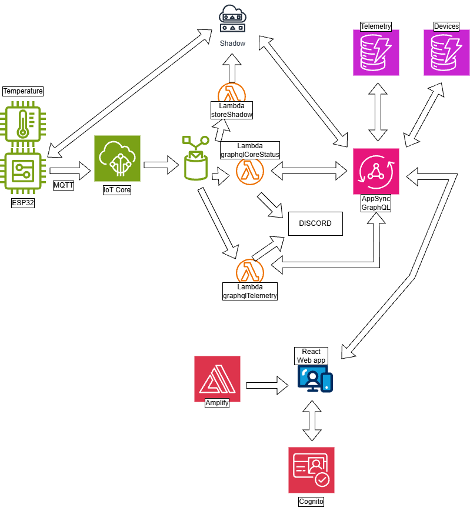
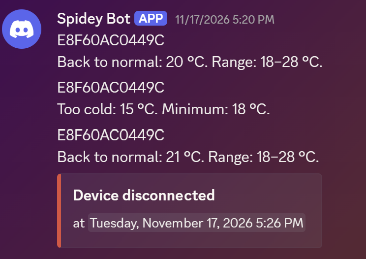

# System architecture

## Intoduction

This project collects temperature measurements and displays them in a graph using a ESP32 with a DHT11 sensor.
Reasoning to why i created this project is because i do not have a way to check temperature in my room so i wanted to create a way to do just that.

## Security

This project uses Cognito to make it so you have to create an account with verification and can only access devices on that account. Each ESP32 needs to have certificates inorder to send MQTT data to the IoTCore

## Scalability

The project is scalable because we are using AWS so you can have as many devices you want aslong as you pay for the amount you will be using.

## How to use

You will need a AWS account to setup IoTCores and setup rules so the Device Shadow is working.
To use the esp32 you will need to set you wifi, aws IoT endpont and certificates in secrets.h

## Software and cloud services

I am using AWS and this are the different components

- IoT Core
- Lambda
- DynamoDB
- Amplify
- Appsync/GraphQL

Images of how the website looks and the discord notifications

