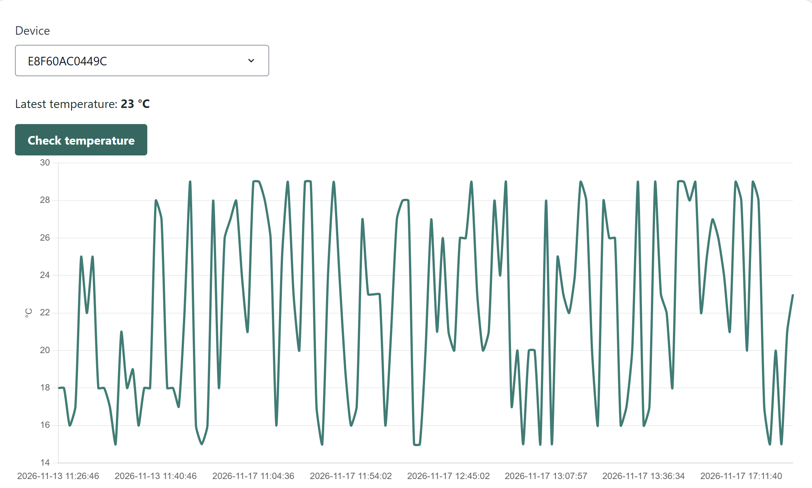
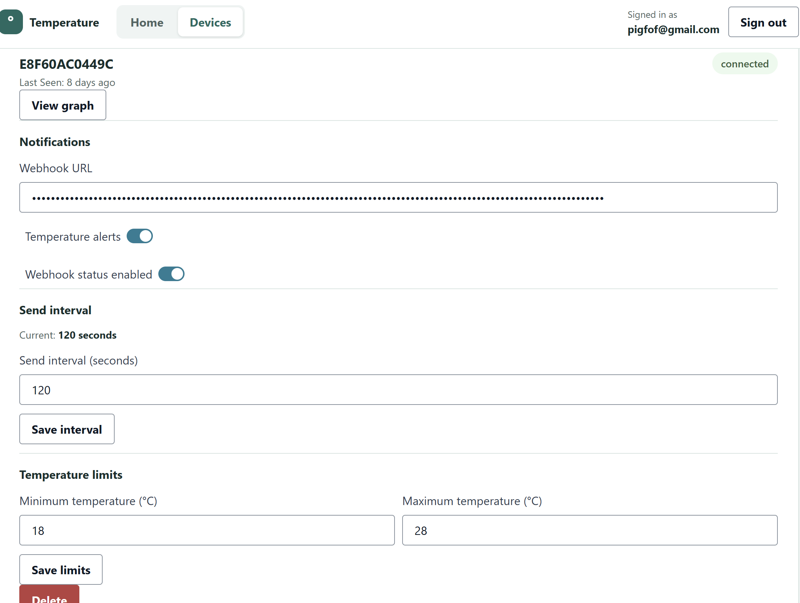
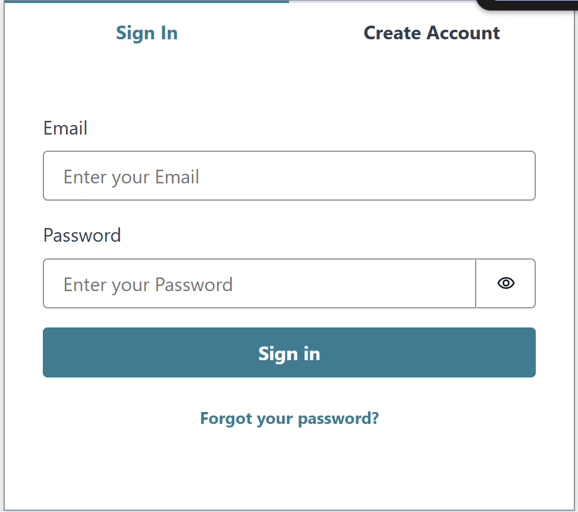

# System architecture

Made with draw.io

## Intoduction

This project collects temperature measurements and displays them in a graph using a ESP32 with a DHT11 sensor.
Reasoning to why i created this project is because i do not have a way to check temperature in my room so i wanted to create a way to do just that.
I wanted to see if you got under or over certain temperatures to know if it was hot enough to turn on ac or cold enough to turn on the heat.

## Security

This project uses Amazon Cognito to manage user registration and login. Users must verify their email address before they can sign in. Each account
can only manage its own registered devices including viewing their graphs and changing device settings.
Each ESP32 uses a certificate and needs to know the AWS IoT Endpoint in order to communicate with the IoT-Core.
Wifi and the Certificate is excluded from git with gitignore.

## Scalability

The project uses AWS cloud services to support additional devices and users as the system grows. This makes it so we reduce the need to maintain
servers manually, however scaling is still subject to costs. So the more we scale the more we need to pay. What could be added is a Amazon S3 storage that
hold archived data from the previous year. Once archived the data is removed from DynamoDB.

## How to use

To set up the project, you need an AWS account with the backend services deployed and the required AWS IoT Core rules configured
to process temperature data and Device Shadow updates.

Before uploading the code to the ESP32, add your Wi-Fi credentials, AWS IoT endpoint, device certificate, and private key to secrets.h.
Once connected the device can send temperature measurements and receive commands through its Device Shadow.

## Software and cloud services

I am using AWS and this are the different components

- IoT Core
- Lambda
- DynamoDB
- Amplify
- Appsync/GraphQL

Images of how the website looks and the discord notifications

